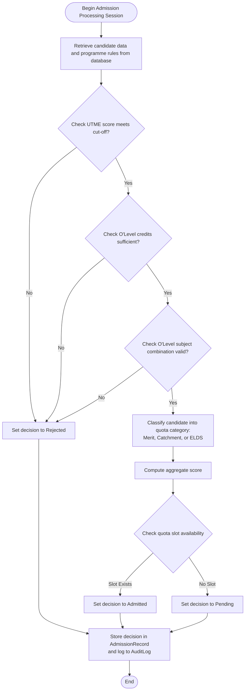
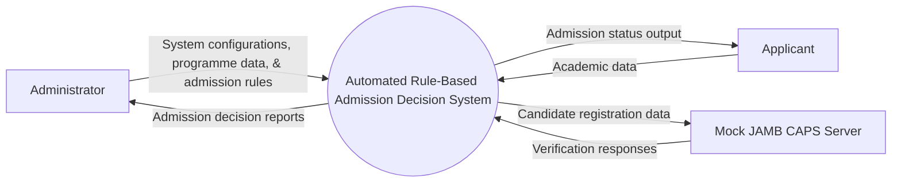
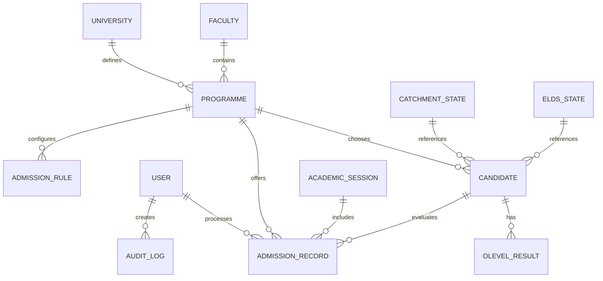
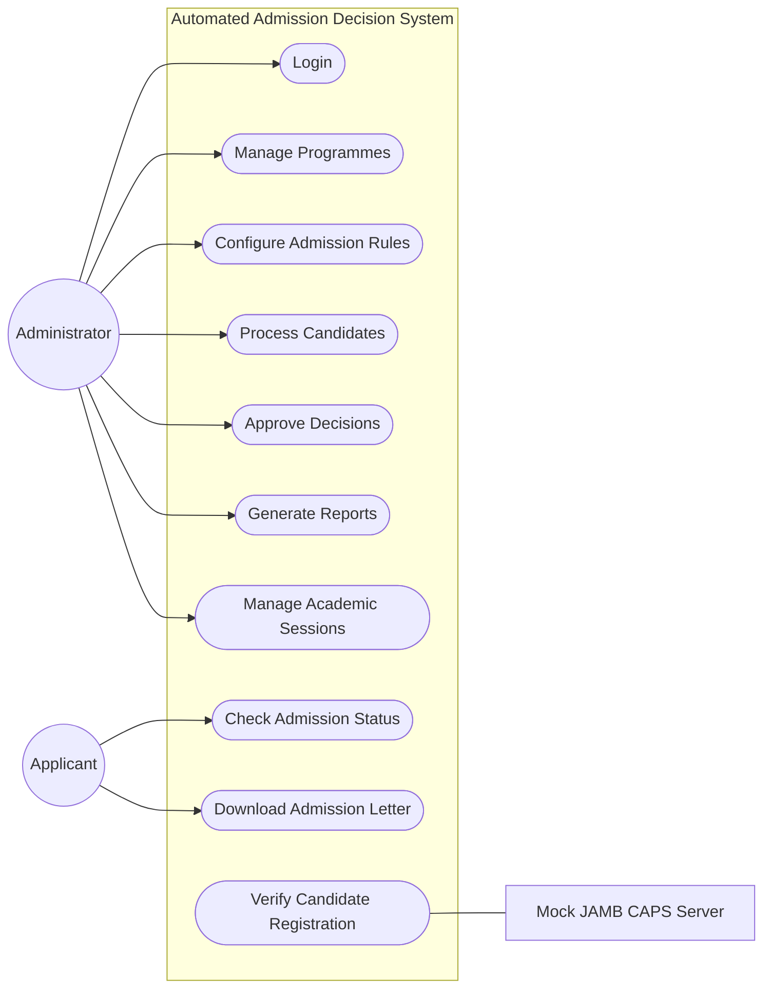
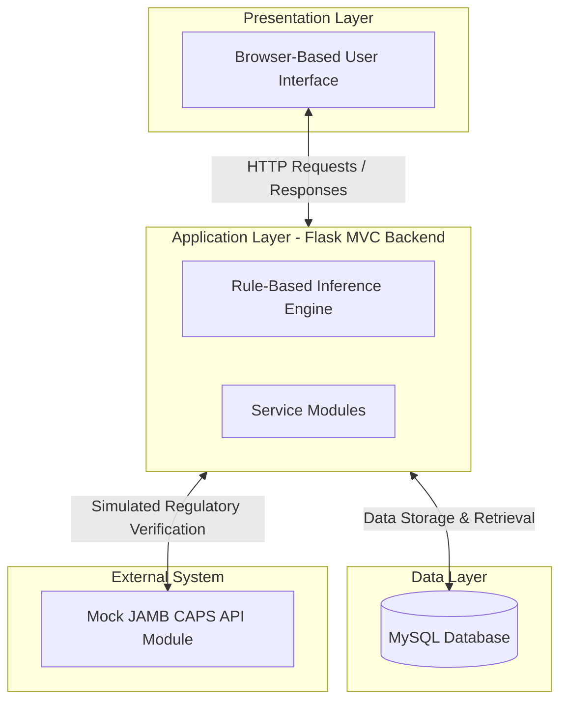

# Automated Admission Decision System - Diagrams

This document contains Mermaid diagrams illustrating the structure, data flows, and architecture of the Automated Admission Decision System.

---

## 1. System Flowchart for the Admission Evaluation Process

---

## 2. Dataflow Diagram (Level 0 DFD)

---

## 3. Entity-Relationship Diagram (ERD)

---

## 4. Use Case Diagram

---

## 5. Three-Tier Architecture

